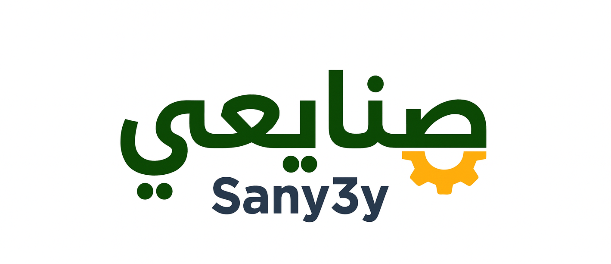
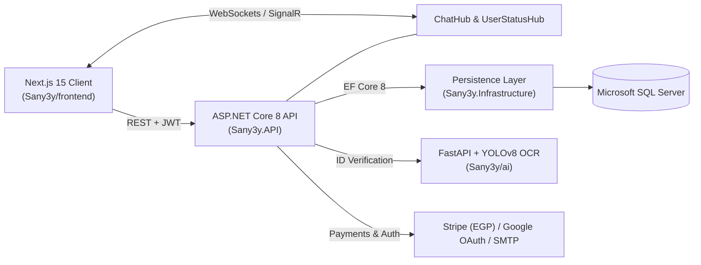

# Sany3y (صنـايعـي)

**A full-stack, decoupled service marketplace connecting clients with verified technicians and maintenance shops across Egypt.**

[About](#about-sany3y) • [Ecosystem](#platform-ecosystem) • [Architecture](#system-architecture) • [Capabilities](#platform-capabilities) • [Tech Stack](#technology-stack) • [Team](#core-team)

---

## About Sany3y

**Sany3y (صنـايعـي)** is a modern service and maintenance marketplace engineered to bring trust, structure, and real-time transparency to home and commercial maintenance across Egypt.

Our platform bridges the gap between **clients** seeking reliable technical services, **independent technicians** managing schedules and bookings, and **local maintenance & hardware shops** establishing a verified digital storefront across Egyptian governorates and cities.

### Engineering Highlights

- **Decoupled Multi-Service Architecture** — Clean separation between the Next.js 15 web client, ASP.NET Core 8 REST & SignalR backend, Entity Framework Core persistence layer, and Python computer vision microservice.
- **AI-Driven Identity Verification** — Automated two-stage **Ultralytics YOLOv8** OCR pipeline (`detect_id_card.pt` & `detect_arabic_numbers.pt`) that extracts and validates 14-digit Egyptian National ID numbers during onboarding.
- **Real-Time Messaging & Live Presence** — JWT-authenticated SignalR WebSocket hubs (`/chatHub` and `/userStatusHub`) powering instant private chat, typing indicators, read receipts, and online/offline availability.
- **Enterprise Identity & Access Control** — ASP.NET Core Identity with stateless JWT Bearer authentication, Google OAuth integration, email confirmation, account lockout policies, and role isolation (`Admin`, `Technician`, `Client`, and `IsShop` entities).
- **Integrated Payments & Arabic RTL Reporting** — Stripe Checkout & Webhook settlement in Egyptian Pounds (EGP) alongside Cash-on-Service, paired with Chart.js telemetry, iTextSharp Arabic RTL PDF reports, and UTF-8 CSV exports.

---

## Platform Ecosystem

| Component | Repository / Module | Responsibility | Stack |
| :--- | :--- | :--- | :--- |
| **Web Client** | [`Sany3y/frontend`](https://github.com/Sany3y/frontend) | Customer, technician, shop, and admin portals with RTL UI and real-time chat | Next.js 15, React 19, TypeScript 5.7 |
| **Computer Vision Service** | [`Sany3y/ai`](https://github.com/Sany3y/ai) | FastAPI inference server executing two-stage YOLOv8 Egyptian National ID OCR | Python 3.10+, FastAPI, YOLOv8, PyTorch |
| **Backend API & Data Layer** | `Sany3y.API` & `Sany3y.Infrastructure` | REST APIs, SignalR hubs, Identity/RBAC, Stripe payments, SMTP, PDF/CSV exports, and EF Core persistence | .NET 8, ASP.NET Core, EF Core 8, SQL Server |

---

## System Architecture

---

## Platform Capabilities

| Role | Key Capabilities |
| :--- | :--- |
| **Clients** | Search technicians and shops by category, governorate, city, price, and rating with Arabic character normalization; inspect real-time availability; book slots with Cash or Stripe online payment; chat in real time; leave verified reviews. |
| **Technicians** | Complete National ID OCR-verified onboarding; configure specialty category, inspection fee, experience, and bio; manage open/booked schedule slots; accept or reject requests and track earnings. |
| **Maintenance Shops** | Dedicated commercial onboarding with shop details, category, establishment date, and owner verification; public storefront discovery with live online status and direct customer messaging. |
| **Administrators** | Monitor platform KPIs and Chart.js growth/demographic analytics (with PNG export); manage users, shops, roles, and service categories; export formatted Arabic RTL PDF and UTF-8 CSV reports. |

---

## Technology Stack

| Layer | Technologies |
| :--- | :--- |
| **Frontend** | Next.js 15 (App Router), React 19, TypeScript 5.7, Bootstrap 5 RTL, Font Awesome 6, `@microsoft/signalr`, Chart.js, Sonner, EmailJS |
| **Backend & Real-Time** | .NET 8, ASP.NET Core Web API, ASP.NET Core Identity, JWT Bearer Auth, SignalR, Stripe.net (v50), Swashbuckle (Swagger/OpenAPI) |
| **Data & Reporting** | Entity Framework Core 8, Microsoft SQL Server, Repository Pattern, iTextSharp (Arabic RTL PDF), UTF-8 CSV Export, SMTP |
| **AI & Computer Vision** | Python 3.10+, FastAPI, Uvicorn, Ultralytics YOLOv8 (PyTorch), Pillow |
| **CI/CD & Tooling** | GitHub Actions, Automated `.NET 8` & `Next.js` build validation |

---

## Core Team

<table width="100%">
  <tr>
    <td align="center" width="25%">
      <a href="https://github.com/Mohammed-3tef">
         
        <b>Mohammed Atef</b>
      </a> 
      <a href="https://www.linkedin.com/in/mohammed-atef-abd-elkader/">LinkedIn</a>
    </td>
    <td align="center" width="25%">
      <a href="https://github.com/Steven-Amin02">
         
        <b>Steven Amin</b>
      </a> 
      <a href="https://www.linkedin.com/in/steven-amin02/">LinkedIn</a>
    </td>
    <td align="center" width="25%">
      <a href="https://github.com/Omniaashraf10">
         
        <b>Omniaa Ashraf</b>
      </a> 
      <a href="https://www.linkedin.com/in/omniaashraf2/">LinkedIn</a>
    </td>
    <td align="center" width="25%">
      <a href="https://github.com/kenzi-shibl">
         
        <b>Kenzi Shibl</b>
      </a> 
      <a href="https://www.linkedin.com/in/kenzi-shibl-2832aa357/">LinkedIn</a>
    </td>
  </tr>
</table>

---

## License

Projects within the **Sany3y** organization are licensed under the **GNU General Public License v3.0 (GPL-3.0)** unless otherwise noted in an individual repository.
